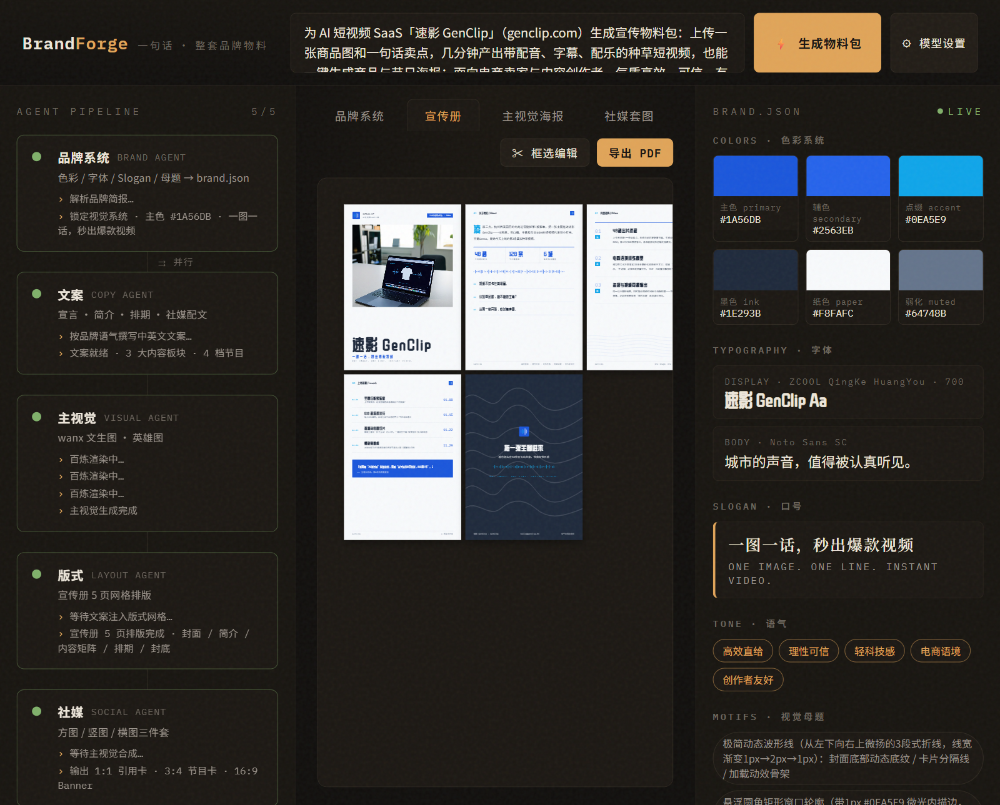
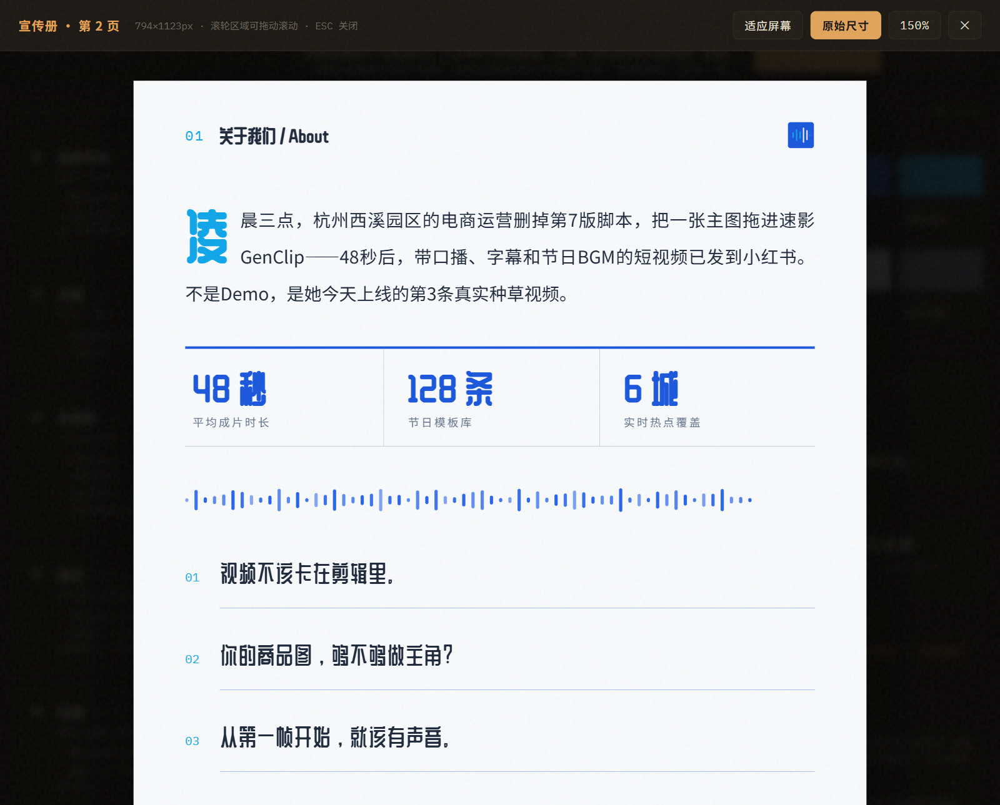
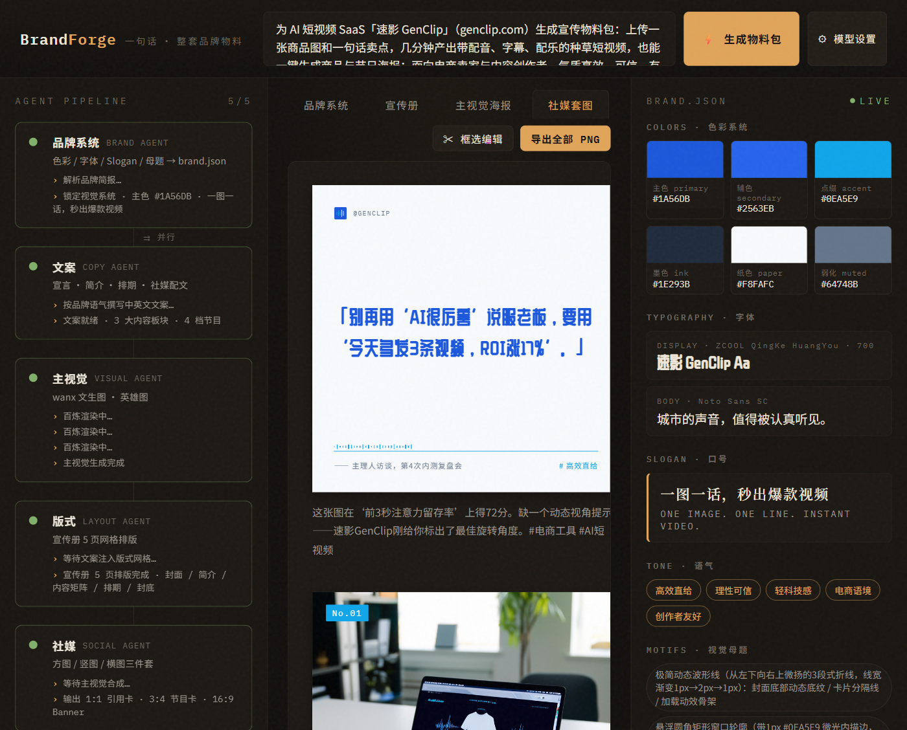
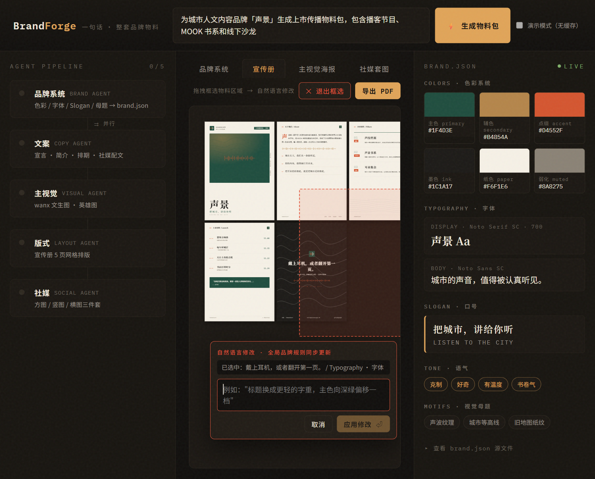
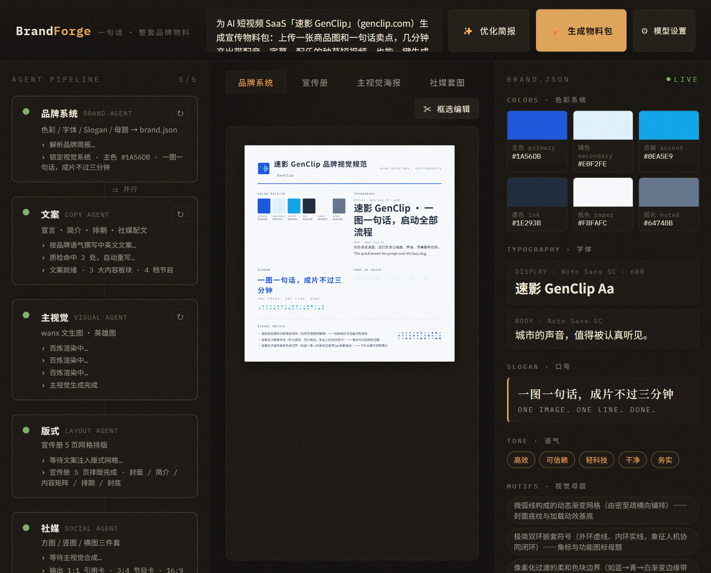
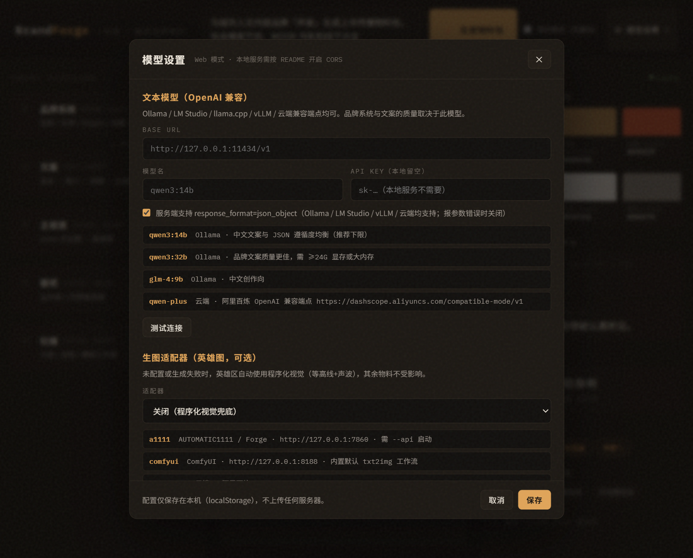

<p align="center">
  <h1 align="center">BrandForge</h1>
  <p align="center"><strong>一句话，生成整套品牌视觉物料</strong><br/>宣传册 · 海报 · 社媒套图 · 品牌规范 —— 风格统一、可编辑、可导出</p>
</p>

> **输入一句品牌简报，1 分钟拿到一整套能直接用的品牌物料。** 不是给你一张图，而是一套系统：
> 品牌规范单页 + **5 页宣传册（PDF 带真实文字层）** + 主视觉海报 + 社媒三件套（方图/竖图/横图）+ **易拉宝（80×200cm 高清打印）**，
> 全部风格统一、全部可改、全部可导出。**免费开源 · 本地运行 · 无水印 · 模型自己配（本地或云端都行）· 没有 GPU 也能用。**

<p align="center">
  
  
  
  
  
  
</p>

---

## ✨ 为什么选 BrandForge

| 独家能力 | 一句话说明 |
|---|---|
| 🖋️ **一句话出整套** | 不是"生成一张图"，是生成**一整套品牌资产**：规范、宣传册、海报、社媒图、易拉宝一次齐 |
| ✍️ **简报 AI 优化** | 口语碎片的描述先经 AI 改写成结构化品牌简报（可继续手改、可撤销），格调从输入端就提上来 |
| 🧬 **改一处，全局一致** | 框选任意区域说一句"主色向深绿偏移一档"，**所有物料秒级同步变**——不是重新生成，是架构保证 |
| ↻ **局部重生成** | 只有海报不满意？点主视觉节点的 ↻ 单独重出一张，其余物料原样不动 |
| ✅ **文案质检层** | 产出先过违禁词/载体词/截断检测，命中自动带违例清单重写一次——不靠人工盯质量 |
| 🖼️ **真实商品入画** | 上传商品实拍图（最多 4 张），商品本体原样入画、AI 只画场景氛围——货不对板从架构上不可能 |
| 📄 **真·文字层 PDF** | 导出的宣传册用 Acrobat 打开**还能继续改字**，不是一张截图糊成的假 PDF |
| 🖥️ **完全本地，数据不出机** | 模型自己配：本地 Ollama / ComfyUI / A1111，或任意云端 API；不上传、不订阅、无水印 |
| 🆓 **没 GPU 也能用** | 没配生图？英雄区自动用程序化视觉兜底，**其余物料丝毫不受影响**，全流程照跑 |
| 👁️ **全程看得见** | 5 个 Agent 谁在干活、谁在等谁、每一步做了什么，实时流水线全透明 |
| 🔍 **点击放大** | 任何物料点一下放大到原始尺寸，小屏看小字不再眯眼 |
| 🅰️ **商用友好** | 字体全部 SIL OFL 免费商用并自托管；产出物版权归你 |

---

## 🎬 效果实拍：一句话进去，一套物料出来

**输入只有这一句话**（真实运行截图，未修图）：

> 为 AI 短视频 SaaS「速影 GenClip」（genclip.com）生成宣传物料包：上传一张商品图和一句话卖点，几分钟产出带配音、字幕、配乐的种草短视频，也能一键生成商品与节日海报；面向电商卖家与内容创作者，气质高效、可信、有科技感但不冷

<table>
  <tr>
    <th align="center">① 宣传册 5 页全览</th>
    <th align="center">② 点击放大 · 原始尺寸细看</th>
    <th align="center">③ 社媒三件套 + 配文</th>
  </tr>
  <tr>
    <td align="center"></td>
    <td align="center"></td>
    <td align="center"></td>
  </tr>
</table>

**产出文案不是模板腔**——下面是同一次运行的真实摘录：

- 📖 宣传册开头：*"凌晨三点，杭州电商运营小陈上传一张新款保温杯图，输入'30秒讲清真空层原理'，按下生成——第147秒，带配音字幕的短视频已发到抖音橱窗。速影 GenClip 不替代人，只把'想清楚'和'做出来'之间那截重复劳动，压进三分钟。"*
- 💬 品牌宣言：*"视频不是等出来的，是推一下就有的。"／"你负责说清楚，我们负责让画面、声音、节奏都听你的。"*
- 📊 数据带：`147 秒 平均成片时长` ／ `62 类 覆盖商品类目` ／ `48 城 上线首月服务城市`
- 🗓️ 四档首发内容形态各不相同：保温杯实测 / 双环调试室 / 收音现场 / 海报圆桌

## 🧬 招牌动作：框选 + 一句话，全局同步变

在宣传册上拖一个框圈住标题，输入 *"主色向深绿偏移一档，标题字重调轻一档"*——
整套物料（宣传册、海报、社媒图、规范页）**同时**按新品牌规则重渲染，一秒完成：

<p align="center"></p>

> 为什么能做到？因为所有物料不是"画"出来的，而是由一份**结构化品牌文件（brand.json）**渲染出来的。
> 模型把你的话翻译成对这份文件的修改（色相/字重/口号），渲染层瞬时响应——**"一处修改、全局一致"不是承诺，是架构**。

---

## 🆚 做一套品牌物料：传统方式 vs BrandForge

| 环节 | 传统外包 | 模板站套版 | BrandForge |
|------|---------|-----------|-----------|
| 品牌规范 | 设计公司 3-5 天 | ❌ 没有 | ✅ 1 分钟自动产出 |
| 宣传册排版 | 设计师 2-3 天 | ⚠️ 逐页手套 | ✅ 自动排版 + 文字层 PDF |
| 海报 + 社媒套图 | 1-2 天 | ⚠️ 逐张手改 | ✅ 三尺寸一次齐 |
| 改稿一轮 | 沟通 1-3 天 | ⚠️ 逐页重改 | ✅ 一句话，秒级全局生效 |
| 风格统一 | 靠设计师经验 | ⚠️ 模板内统一 | ✅ 同一套品牌 token 驱动，物理上不可能漂移 |
| 成本 | ¥5,000 - 30,000 | 订阅制 | **软件免费；模型费本地 ¥0 / 云端约 ¥0.1-0.3 一套** |
| 交付周期 | 1-2 周 | 半天 | **约 1 分钟** |

### 和同类工具比呢？

| 你在意的 | **BrandForge** | 纯生图模型 | 模板站 AI 工具 | 商业品牌 SaaS |
|---|:---:|:---:|:---:|:---:|
| 整套物料风格统一 | ✅ 同一品牌文件驱动 | ❌ 每张各自漂移 | ⚠️ 模板内统一 | ⚠️ 看套餐 |
| 产出可继续编辑 | ✅ PDF 文字层 + token 重渲染 | ❌ 文字是像素 | ⚠️ 站内可改 | ⚠️ 部分 |
| 商品图真实性 | ✅ 实拍图架构级保证 | ❌ AI 想象的商品 | ⚠️ 手动逐张替换 | ⚠️ |
| 一句话全局改稿 | ✅ | ❌ 重抽卡碰运气 | ❌ 逐页手改 | ⚠️ 按次收费 |
| 数据隐私 | ✅ 全本地 | ❌ 上传云端 | ❌ 上传云端 | ❌ 上传云端 |
| 价格 | ✅ 免费开源 | 按张计费 | 订阅 | 订阅/项目制 |
| 无水印 | ✅ | ✅ | ⚠️ 免费档常有 | ⚠️ |

---

## 🚀 30 秒跑起来

**第 1 步 · 装上**（任选其一）：

```bash
# 方式 A：源码体验（需 Node 18+）
git clone https://github.com/coolhfei/BloomPen.git && cd BloomPen
npm install && npm run dev        # 打开 http://localhost:5173

# 方式 B：本地打包桌面客户端（Windows 安装版/免安装版）
npm install && npm run dist:win   # 安装包在 release/ 目录
```

> 📦 **不想折腾环境？直接下载现成客户端** → [Releases](https://github.com/coolhfei/BloomPen/releases/latest)：Windows 安装版（setup）/ 免安装版（portable，双击即用）、macOS（Apple 芯片 / Intel 两版）。

**第 2 步 · 配模型**（打开应用内 **⚙ 模型设置**，三选一）：

| 你的情况 | 填什么 |
|---|---|
| 有显卡，想完全免费离线 | 装 [Ollama](https://ollama.com) → `ollama pull qwen3:14b` → 填 `http://127.0.0.1:11434/v1` + 模型名 `qwen3:14b` |
| 没显卡，想用云端 | 填任意 OpenAI 兼容端点（阿里百炼 / DeepSeek / Kimi / OpenAI…）+ 你的 Key |
| 只想先玩玩版式 | 生图适配器选"关闭"，**不配任何模型也能看全流程**（英雄区用程序化视觉） |

**第 3 步 · 出活**：输入框里一句话 → ⚡ 生成物料包 → 看流水线跑完 → 导出 PDF / PNG。

> 🧑‍ 设置页每个选项旁都有"测试连接"按钮和推荐模型清单，点一下就知道通没通。

## 界面预览

| 品牌规范单页 · 自动生成 | 模型设置 · 本地/云端自配 |
|:---:|:---:|
|  |  |

---

## ❓ 常见问题 FAQ

**完全不懂设计能用吗？**
能。你只需要会打字。品牌色、字体、版式、文案全部由 AI 产出并保持一致；不满意就框选区域说一句话，或点"重新生成"。

**真的免费吗？钱花在哪？**
软件免费开源（AGPL-3.0）。唯一可能的花费是你自己选的模型：本地 Ollama = ¥0；云端 API 按量计费，整套物料通常 ¥0.1-0.3。

**可以商用吗？**
可以。产出的物料归你；字体全部 SIL OFL 免费商用。AGPL 约束的是**软件本身**：你可以免费商用本软件，但若修改后通过网络对外提供服务，需开源你的修改。

**我的数据会上传吗？**
不会。软件完全本地运行，只与你配置的模型端点直连（本地模型则全程不出机）。配置与密钥只存在你本机。

**macOS 打开提示「已损坏」或「无法验证开发者」？**
发布包未做 Apple 签名（证书年费所限）。处理：右键应用图标 →「打开」→ 再点「打开」即可；仍不行就在终端执行 `xattr -cr /Applications/BrandForge.app` 后重新打开。

**没有 GPU / 不配生图会怎样？**
全流程照跑：英雄图区域自动使用程序化视觉（等高线+声波图形），宣传册/海报/社媒图的文字版式完全不受影响。

**物料上的商品是真实商品吗？**
上传商品图后是——你传什么，物料上就印什么（透明底自动合成进 AI 场景背景，白底/实拍图以卡片式版式入画）。抠图在安装包内本地完成，不出机。不传图则走 AI 主视觉/程序化兜底，适合 SaaS、活动等无实物品牌。

**生成的 PDF 真的能改吗？**
能。导出走真实文字层，Acrobat / WPS 打开可直接编辑文字；想大改就回应用里框选编辑或改 brand.json 后重渲染。

**小屏幕看不清物料小字？**
点击任意物料放大到原始尺寸（100% / 150% 可调），或导出后看文件。

**支持哪些生图服务？**
AUTOMATIC1111 / Forge、ComfyUI、阿里百炼、OpenAI 兼容 images 端点；不配则程序化兜底。文本模型支持任意 OpenAI 兼容端点（含 Ollama 本地）。

**能离线运行吗？**
配本地模型后完全离线。未配模型时也可离线浏览内置示例品牌与全部界面。

---

## 🧩 核心能力一览

- **5 Agent 协作流水线**：品牌系统 →（文案 ∥ 主视觉）→ 版式 / 社媒，并行依赖实时可视化
- **简报 AI 优化**：口语碎片 → 结构化品牌简报，可手改可撤销
- **局部重生成**：品牌/文案/主视觉三源头节点各自 ↻，其余产物不动
- **文案质检层**：违禁词/载体词/截断检测 + 违例清单自动重写，场景无关
- **四类交付物**：品牌规范单页 ／ 宣传册 5 页（A4）／ 主视觉海报（2:3）／ 社媒三件套（1:1、3:4、16:9 精确像素）／ 易拉宝（80×200cm，150dpi 打印级导出）
- **真实商品图入画**：图集上传（≤4 张）· 本地抠图（透明底直通 / 内置 ISNet / ComfyUI 可选）· composite/embed 智能降级 · 换图不重生成
- **brand.json 实时检视器**：色板（点击复制 hex）/ 字体 / 口号 / 语气 / 视觉母题，编辑即闪变
- **框选自然语言编辑**：色相族跳转 + "一档"步长契约（代码强制 S/L 变化 ≤10），改得准、改得稳
- **自适应版式**：大标题按字数分档缩字号，长文案不破版
- **导出矩阵**：宣传册 PDF（文字层）· 海报/社媒 PNG（精确尺寸）· 点击放大核对细节
- **字体自托管**：思源宋/黑（可变字重）、站酷小薇、庆科黄油、马善政楷、龙藏体、IBM Plex Mono，离线可用

<details>
<summary><b>🧑‍💻 开发者：架构与贡献</b></summary>

- 三层分离：`src/lib/providers/`（唯一碰模型 API 的适配器层）· 编排与提示词 · 纯展示模板层（只消费 CSS 变量）
- 桌面壳：Electron（IPC 桥消灭 CORS + 隐藏窗口 printToPDF）；渲染进程零 Node 权限 + CSP 加固
- 开发：`npm run dev`（Web）／`npm run electron:dev`（桌面联调）／`npm run dist`（三平台打包）
- 贡献指南与铁律见 [CONTRIBUTING.md](CONTRIBUTING.md)；字体归属见 [FONTS.md](FONTS.md)；许可见 [LICENSE](LICENSE)

</details>

**关键词 / Keywords**: 品牌物料生成 · AI 宣传册 · 品牌手册 · VI 设计 · 一句话生成设计 · 社媒套图 · 海报生成 · brand kit generator · AI brochure · brand guidelines · design tokens · 本地优先 · 开源客户端 · Ollama · ComfyUI · AGPL

---

<p align="center"><sub>BrandForge · AGPL-3.0 · 字体 SIL OFL · 模型权重由用户自备并遵守各自许可</sub></p>
